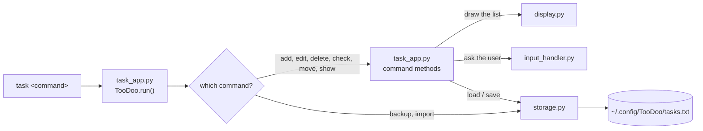

<div align="center">

# ✅ TooDoo

**A fast, friendly to-do list manager that lives in your terminal.**

This isn't your ordinary to-do list app; it has features that set it apart, and — most importantly — it's user-friendly and runs in the terminal.


[Features](#-features) · [Installation](#-installation) · [Quick start](#-quick-start) · [Command reference](#-command-reference) · [Your data](#-your-data) · [How it works](#-how-it-works) · [Troubleshooting](#-troubleshooting)

</div>

---

## 📖 Overview

TooDoo works like `git`: one command, **`task`**, followed by a sub-command.

Every sub-command can be typed in a single line, **or** you can leave the details out and TooDoo will show your list and ask you for them. There is no account, no internet connection and no database — your tasks are kept in a small JSON file on your own machine.

```console
$ task add Buy milk
Description: 2 liters, low-fat

$ task -a "Call mom" "Sunday evening"

$ task done 1
$ task mv 2 1
$ task show
╭───┬────┬──────────┬───────────────────╮
│ # │ ✓  │ Task     │ Description       │
├───┼────┼──────────┼───────────────────┤
│ 1 │ ⬜ │ Call mom │ Sunday evening    │
│ 2 │ ✅ │ Buy milk │ 2 liters, low-fat │
╰───┴────┴──────────┴───────────────────╯
 2 tasks · 1 done · 1 pending
```

## ✨ Features

| | Feature | Details |
|---|---|---|
| ⌨️ | **Git-style commands** | One `task` command, many sub-commands, each with short aliases (`rm`, `mv`, `-a`, `-b`, ...). |
| 🔢 | **Number *or* title** | Point at a task by its number in the list or by its exact title — it works in every command. |
| 💬 | **Interactive *or* one-liner** | Give all the arguments and it just runs; leave them out and TooDoo asks. |
| 🎨 | **A list that looks good** | A tidy table with colors, wrapped long text and a summary line; it adapts to the width of your terminal. |
| ✅ | **Check / uncheck** | Finished tasks get a ✅ (and are dimmed) in the list. |
| ✏️ | **Edit** | Change a title and description; press <kbd>Enter</kbd> to keep the old value. |
| ↕️ | **Reorder** | Move a task to a new position, or swap two tasks. |
| 🕒 | **Timestamps** | Every task remembers when it was added. |
| 💾 | **Backup & import** | Save and restore all your tasks with one command. |
| 🪶 | **Zero dependencies** | Pure Python standard library. |
| 🔒 | **Private & local** | Everything stays in `~/.config/TooDoo`. |

## 📦 Installation

### Requirements

- **Python 3.9 or newer**
- No third-party packages

### Install from source

Get the project (`git clone` or download it), open a terminal in the project folder and run — ideally inside a virtual or conda environment:

```bash
pip install .
```

This installs the **`task`** command. Check that it works:

```bash
task show
```

If you want to install straight from GitHub (replace the placeholder with the real address of the repository):

```bash
pip install git+https://github.com/<your-username>/TooDoo.git
```

### Run without installing

```bash
python task_app.py show
```

Anywhere in this README, `task <command>` can be replaced with `python task_app.py <command>`.

### Update and uninstall

```bash
pip install --upgrade .     # after pulling new changes
pip uninstall TooDoo        # remove the command (your tasks are NOT deleted)
```

## 🚀 Quick start

```bash
# 1. add a few tasks
task add Buy milk                  # asks for a description
task -a "Call mom" "Sunday"        # title and description in one line

# 2. look at them
task show

# 3. finish one
task done 1

# 4. change your mind
task undone 1

# 5. tidy up
task mv 2 1                        # make task 2 the first one
task rm "Call mom"                 # delete by title

# 6. keep a safety copy
task -b
```

## 📚 Command reference

```text
task <command> [arguments]
```

| Action | Commands | Needs arguments? |
|---|---|---|
| [Add](#add) | `add`, `-a` | optional |
| [Show](#show) | `show` | no |
| [Edit](#edit) | `edit` | optional (task) |
| [Check](#check--uncheck) | `check`, `done` | optional (task) |
| [Uncheck](#check--uncheck) | `uncheck`, `undone` | optional (task) |
| [Delete](#delete) | `delete`, `del`, `-d`, `rm`, `remove` | optional (task) |
| [Move](#move-and-swap) | `move`, `mv` | optional (task, position) |
| [Swap](#move-and-swap) | `amove`, `amv` | optional (task, task) |
| [Backup](#backup) | `backup`, `bc`, `-b`, `export` | no |
| [Import](#import) | `import`, `-i` | no |

Running `task` with no command prints `Usage: task <command>`. An unknown command prints `<command> command not found!!`.

### Choosing a task

Every command that works on an existing task (`edit`, `check`, `uncheck`, `delete`, `move`, `amove`) understands two ways of naming it:

| You type | Meaning |
|---|---|
| `2` | the task at position 2 in the list |
| `Buy milk` | the task whose title is exactly `Buy milk` |

Good to know:

- Titles are matched **exactly** (capital letters matter). If two tasks share a title, the first one wins.
- A title is checked **before** a number, so a task literally called `2` is found by its title.
- Typing **`0`** cancels the command — and so does pressing <kbd>Enter</kbd> at a prompt.
- Numbers outside the list (`0`, negative, too big) never touch a task; you'll see `This task doesn't exist!!`.
- If you leave the task out, TooDoo prints the list and asks:

  ```text
  Which task do you want to delete: 
  ```

  A wrong answer is not an error — it prints the valid answers and asks again.
- In commands that take **one** task (`edit`, `check`, `uncheck`, `delete`) everything after the command is treated as the title, so quotes are optional: `task del Buy milk` works.

### Add

| Form | What happens |
|---|---|
| `task add` | asks for the task, then for the description |
| `task add Buy milk` | title is `Buy milk` (all words are joined), then asks for the description |
| `task -a "Buy milk" "2 liters"` | title and description are both taken from the command line |
| `task -a "Buy milk"` | title from the command line, then asks for the description |

Each new task is saved with its title, description, an unchecked state and the date and time it was added.

### Show

```console
$ task show
╭───┬────┬──────────────┬───────────────────╮
│ # │ ✓  │ Task         │ Description       │
├───┼────┼──────────────┼───────────────────┤
│ 1 │ ⬜ │ Call mom     │ Sunday evening    │
│ 2 │ ✅ │ Buy milk     │ 2 liters, low-fat │
│ 3 │ ⬜ │ Write report │ Quarterly numbers │
╰───┴────┴──────────────┴───────────────────╯
 3 tasks · 1 done · 2 pending
```

- The **`#`** column is the number you can use in other commands (`task rm 2`).
- ⬜ means *not done*, ✅ means *done*. Finished tasks are also dimmed and struck through when your terminal supports it.
- The table **fits your terminal**: long titles and descriptions are wrapped onto several lines instead of breaking the layout.
- Wide characters (for example Chinese or Japanese) and emoji are measured correctly, so the columns stay aligned.
- The last line is a short summary: how many tasks you have, how many are done and how many are still pending.
- When nothing is saved yet you'll see `No task added!!!`.

**Colors** (cyan header, dim borders, bold titles) are only used when the output goes to a real terminal. When you pipe the output (`task show | less`) or set the `NO_COLOR` environment variable, you get plain text:

```bash
NO_COLOR=1 task show
```

### Edit

```console
$ task edit 2
Buy milk change to: Buy oat milk
Enter description: 
```

You are asked for a new title and a new description. **Press Enter to keep the current value** — you can change only the title, only the description, or both.

### Check / uncheck

| Command | Result |
|---|---|
| `task check 1` or `task done 1` | marks the task as done (✅) |
| `task uncheck 1` or `task undone 1` | marks it as not done again |

These set the state explicitly — running `done` twice leaves the task done.

### Delete

```bash
task rm 3                 # by number
task del Buy milk         # by title
task delete               # shows the list and asks
```

Deleting is immediate and there is no undo, so make a [backup](#backup) first if you are unsure.

### Move and swap

`move` takes a task out of the list and puts it at a new position. `amove` swaps two tasks and leaves everything else where it is. Both accept numbers or titles.

```bash
task mv 3 1                    # task 3 becomes the first task
task mv "Write report" 2       # by title
task mv 1 "Buy milk"           # put task 1 where "Buy milk" is
task amv 1 4                   # tasks 1 and 4 trade places
task mv                        # shows the list and asks both questions
```

Example, starting from `A B C D`:

| Command | Result |
|---|---|
| `task mv 1 3` | `B C A D` |
| `task mv 4 1` | `D A B C` |
| `task amv 1 4` | `D B C A` |

Because both a task *and* a position are needed, **titles that contain spaces must be quoted** here.

### Backup

| Command | What it does |
|---|---|
| `task -b` | Saves the backup straight into your home folder |
| `task backup` · `task bc` · `task export` | Asks which folder to save the backup in |

When asked for a folder:

- press <kbd>Enter</kbd> for your home folder,
- `~` works (for example `~/Documents`),
- `0` cancels,
- a folder that doesn't exist is rejected and you are asked again.

The backup is a copy of your task file, named **`TooDoo.backup.Jaraare`**. If you have no tasks yet you'll see `No task added!!!`.

### Import

| Command | What it does |
|---|---|
| `task -i` | Restores the backup found in your home folder |
| `task import` | Asks which folder the backup is in (Enter = home, `0` = cancel) |

> ⚠️ **Importing replaces all your current tasks**, and the backup file is **moved** into place (it is not copied), so it is gone from its old location afterwards. If you want to keep it, copy it somewhere else first.

## 💾 Your data

| | |
|---|---|
| **Linux / macOS** | `~/.config/TooDoo/tasks.txt` |
| **Windows** | `%USERPROFILE%\.config\TooDoo\tasks.txt` |
| **Backup file** | `TooDoo.backup.Jaraare` |

The folder is created automatically the first time something is saved. The file is plain JSON, so you can read it, version it or edit it with any tool:

```json
[
  {
    "title": "Buy milk",
    "description": "2 liters, low-fat",
    "task_done": false,
    "task_id": null,
    "adding date": "2026-11-04 Wed 19:18:49"
  }
]
```

| Field | Meaning |
|---|---|
| `title` | the task's name |
| `description` | free text |
| `task_done` | `true` once checked |
| `task_id` | reserved, currently always `null` |
| `adding date` | when the task was added (`YYYY-MM-DD Weekday HH:MM:SS`) |

The order of the tasks in the file is the order you see in `task show`.

To start over from scratch, delete the file `tasks.txt`.

## 🧩 How it works



| File | Purpose |
|---|---|
| `task_app.py` | The `task` command: reads the sub-command, runs it, and holds the `Task`, `Default` and `TooDoo` classes. |
| `display.py` | Draws the task list as a colored, box-drawn table that fits the terminal (used by `task show`). |
| `storage.py` | Reads and writes the JSON task file; does backup and import. |
| `input_handler.py` | A reusable helper that asks a question and keeps asking until the answer is valid (text or numbers, allowed ranges, allowed options, default value). |
| `pyproject.toml` | Packaging information; it is what creates the `task` command. |

A task is represented by two small classes: `Task` (title, description, done flag) and `Default`, which also records the date it was added.

## 🛠 Development

```bash
git clone https://github.com/<your-username>/TooDoo.git
cd TooDoo
pip install -e .          # editable install: changes take effect immediately
task show
```

You can also skip the install and run `python task_app.py <command>` from the project folder.

## 🩺 Troubleshooting

| Problem | What to try |
|---|---|
| `task: command not found` | Activate the environment you installed into (virtual or conda), or make sure pip's scripts folder is in your `PATH`. As a fallback use `python task_app.py ...`. |
| `No task added!!!` | There are no tasks yet — add one with `task add`. |
| `This task doesn't exist!!` | The number is outside the list, or the title doesn't match exactly (check capital letters and spaces). Run `task show` to see the list. |
| `<word> command not found!!` | The sub-command doesn't exist; see the [command reference](#-command-reference). |
| A title with spaces is not understood by `move` / `amove` | Put the title in quotes: `task mv "Buy milk" 1`. |
| `File doesn't exist!!!` when importing | The backup `TooDoo.backup.Jaraare` is not in the folder you gave (or in your home folder for `task -i`). |
| ✅ / ⬜ show as a box or question mark, or the table borders look broken | Your terminal font lacks the emoji or box-drawing characters; use a different font or terminal (for example Windows Terminal instead of the old console). |
| The table has no colors | Colors are switched off when the output is piped, when `TERM=dumb`, or when `NO_COLOR` is set. |
| The columns look slightly shifted with right-to-left text (Persian, Arabic) | Most terminals don't fully support right-to-left text; the table is still measured correctly, but the display depends on your terminal. |

## 🤝 Contributing

Bug reports and ideas are welcome — open an issue or a pull request. If you change behaviour, please update this README too.

---

<div align="center">

Made with ❤️ for people who live in the terminal.

</div>